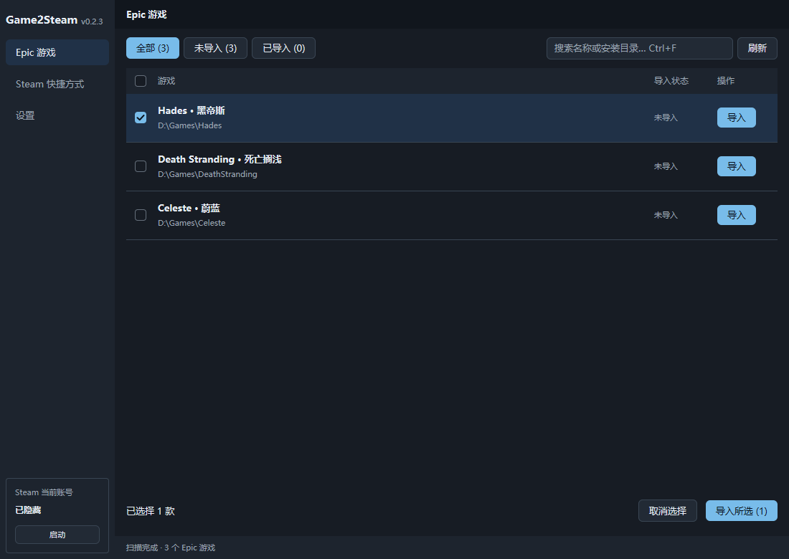
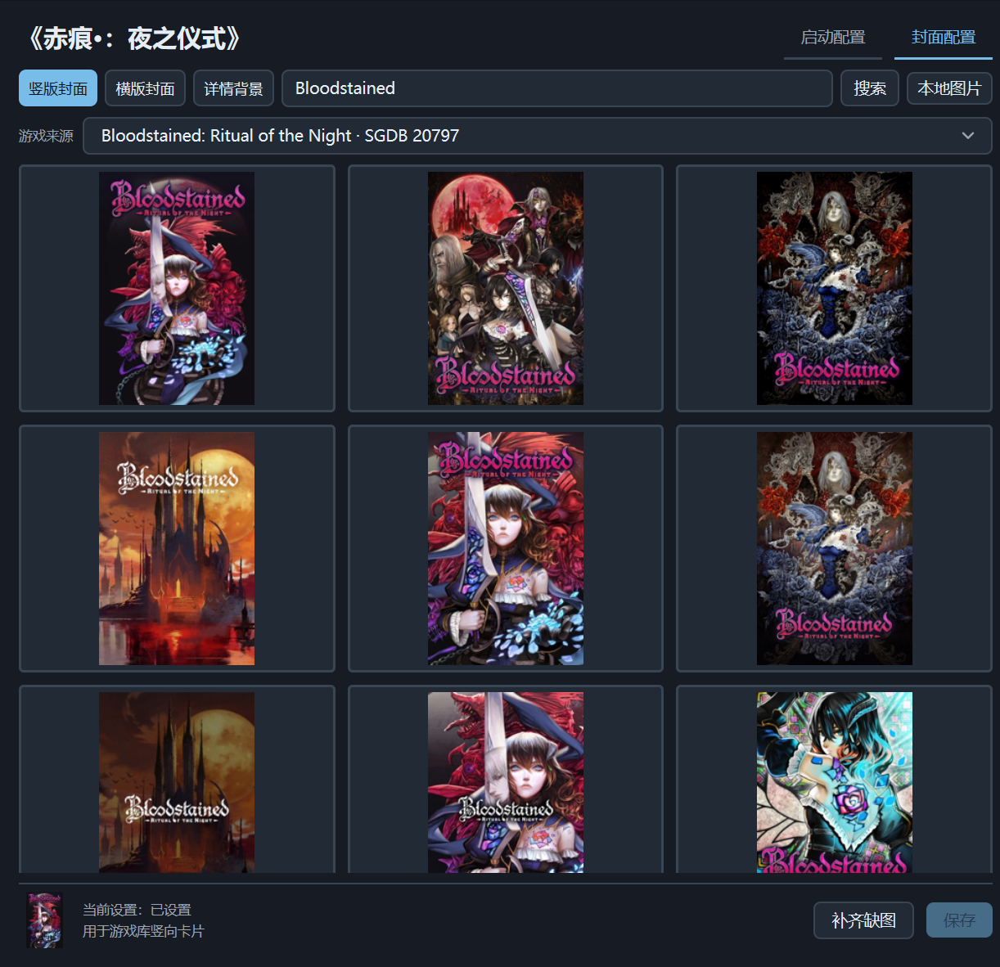
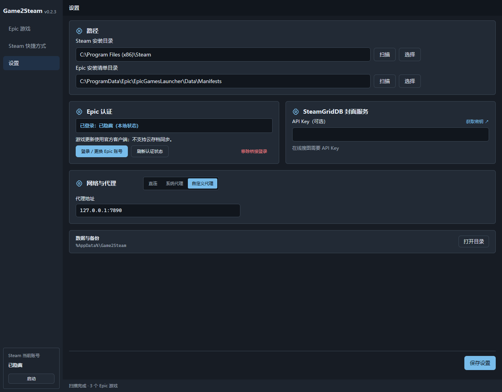

# Game2Steam

将本机已安装的 Epic 游戏加入 Steam，管理非 Steam 快捷方式、启动参数和封面。

[下载 Windows 版](https://github.com/daief/game-to-steam/releases/latest)

支持 Windows 64 位。使用便携版时，将 `Game2Steam.exe` 与 `epic-bridge.exe` 放在同一目录。

## 导入游戏

1. 在“设置”中登录 Epic：打开登录网页，完成登录后粘贴返回的授权码。
2. 退出 Steam，在“Epic 游戏”中选择游戏，单项或批量导入。
3. 启动 Steam，从游戏库运行新增的游戏。

路径未识别时，可在设置中点击“扫描”或“选择”。遇到已有快捷方式时，核对后选择接管或跳过。

## 管理快捷方式

- 查看当前 Steam 账号的非 Steam 游戏，支持搜索和批量删除。
- 在“启动配置”中编辑游戏参数；高级设置可修改启动程序、工作目录和完整参数。
- 删除快捷方式时可同时清理封面，游戏文件保留。

已导入或接管的 Epic 游戏可编辑；其他快捷方式支持查看和删除。

## 设置封面

在游戏的“封面配置”中选择竖版封面、横版封面或详情背景，点击候选图片后保存，也可选择本地 PNG/JPEG。

在线搜索需要 [SteamGridDB API Key](https://www.steamgriddb.com/profile/preferences/api)。“补齐缺图”只补充缺失的图片。

## 设置

支持路径扫描与文件夹选择、Epic 登录、SteamGridDB API Key，以及直连、系统代理和自定义代理。自定义代理填写 `IP:端口`，修改后保存。

左下角 Steam 账号区可启动、打开或请求退出 Steam。

## 使用范围与数据

- 仅扫描本机已安装的 Epic 游戏，操作最近使用的 Steam 账号。
- 游戏通过独立认证桥接启动，需先登录 Epic；安装与更新仍由 Epic 客户端管理，不提供云存档同步。
- Steam 运行时无法保存，退出后再操作。
- 设置、游戏关联与备份位于 `%AppData%\Game2Steam`；写入 Steam 文件前自动备份。
